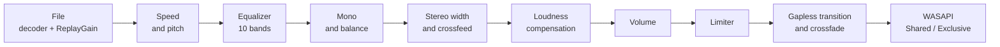

<div align="center">


# Lumisense

**A local audio player for Windows in the spirit of Fluent Design.**<br>
Your music stays on your disk: no streaming, no accounts, no subscriptions.

[Русский](README.md) · [English](README.en.md)

[](https://github.com/wasssly/Lumisense/releases)
[](https://github.com/wasssly/Lumisense/actions/workflows/ci.yml)
[](https://github.com/wasssly/Lumisense)
[](https://dotnet.microsoft.com/)
[](LICENSE)
[](https://t.me/LumisenseApp)

[**Download**](https://github.com/wasssly/Lumisense/releases) · [Features](#highlights) · [Audio](#signal-path) · [Privacy](#privacy) · [Build](#building-from-source) · [Feedback](#feedback)

</div>

<br>

## Highlights

<table>
  <tr>
    <td valign="top" width="33%"><b>Uncompromising sound</b><br>Ten-band equalizer, limiter, ReplayGain and EBU R128 loudness measurement, crossfade, gapless transitions, WASAPI Exclusive.</td>
    <td valign="top" width="33%"><b>Live lyrics</b><br>Synced <code>.lrc</code>, LRCLIB search, styling presets and a full-screen Now Playing with an animated background.</td>
    <td valign="top" width="33%"><b>Five window layouts</b><br>New, Glass, Vinyl, Compact and Poster, plus a mini player and a floating Island.</td>
  </tr>
  <tr>
    <td valign="top" width="33%"><b>A library without surprises</b><br>Folders, favorites, queue, five shuffle modes, tag and cover editor, online cover search.</td>
    <td valign="top" width="33%"><b>Private by default</b><br>Online features are optional and listed in <a href="docs/NETWORK_AND_PRIVACY.md">a single document</a>. Logs never leave your computer.</td>
    <td valign="top" width="33%"><b>Safe updates</b><br>GitHub Releases, SHA-256 verification, build attestation, compact Velopack updates.</td>
  </tr>
</table>

> **Disclaimer.** Lumisense was largely created with the help of **Claude** and **Manus AI** and was originally developed for personal use, around the author's habits and preferences, not as a universal product for everyone. Some decisions may therefore be subjective, and some features may still need polish. If you find a bug or miss an important feature, please open an [issue](https://github.com/wasssly/Lumisense/issues).

## Installation

| What you need | What to download from [GitHub Releases](https://github.com/wasssly/Lumisense/releases) |
|:--|:--|
| Regular installation and updates | **`Lumisense-<version>-Setup.exe`** |
| Compact Velopack updates | `Lumisense-<version>-win-x64.msi`: optional, Windows asks for administrator rights |
| Service files | `.nupkg`, `RELEASES`, `releases.win.json`: do not run them manually |

A walkthrough of the release files and the EXE/MSI scenarios: [docs/UPDATES.md](docs/UPDATES.md). News and announcements are in Telegram: [@LumisenseApp](https://t.me/LumisenseApp).

## Features

Sections are collapsed to keep the page easy to scan: expand the one you need.

<details open>
<summary><b>Playback and queue</b></summary>

<br>

- **Formats:** MP3, WAV, WMA, FLAC, M4A, AAC, OGG, OPUS, AIFF.
- **Controls:** play, pause, stop, previous and next track, seeking; repeat is off, whole playlist or a single track.
- **Play next:** a separate queue with search and sorting; the queue and the shuffle history are kept between launches.
- **Transitions:** gapless (beta) and crossfade on automatic track changes; tracks of the same album can be left unmixed.
- **Memory:** the last track and position are remembered; resuming on startup can be turned off.

**Shuffle modes**

| Mode | How the next track is chosen |
|:--|:--|
| **Deck** (default) | The playlist is shuffled once, and a track does not repeat until all the others have played |
| **Random** | Any track from the whole playlist; repeats are possible, but never twice in a row |
| **Favorites more often** | Favorites come up three times as often as the rest |
| **Rarely played more often** | Tracks you have listened to least (by play count) come up more often |
| **By folder** | A folder or album plays in a row, then a random one that has not played yet; folders do not repeat until all have played |

</details>

<details>
<summary><b>Audio</b> (the processing chain is described in <a href="#signal-path">Signal path</a>)</summary>

<br>

- **Equalizer:** ten bands, presets and your own settings; switching it on is click-free, and a disabled equalizer does not process the sound.
- **Speed and pitch** without changing the source file; speed can also change pitch, "like on a record".
- **Loudness:** ReplayGain (track and album modes, preamp, Opus R128). For files without tags the player measures loudness by EBU R128 in the background and levels it to −18 LUFS. The volume curve is logarithmic or linear.
- **Limiter:** transparently attenuates only peaks above −0.1 dBFS (about 2 ms of latency).
- **Space:** stereo width, crossfeed for headphones, loudness compensation, mono mode and balance.
- **Output:** any Windows device; the equalizer and balance can be remembered per device. WASAPI Shared (default) or Exclusive with automatic fallback to Shared, adjustable latency and elevated process priority. If the saved device disappears, sound is restored on the system one.
- **Signal path:** a line in the output settings shows which processing stages are on; "bit-perfect" is shown only with no processing, in Exclusive mode and at the file's sample rate.
- **MP3 export** with the current speed and pitch; the original is never overwritten. Encoding is done by the built-in LAME (libmp3lame), no Windows codecs required.

</details>

<details>
<summary><b>Playlist and collection</b></summary>

<br>

- **Contents:** files, folders (nested and empty), grouping by folder, collapsible groups, disabling individual folders; new files in watched folders are picked up automatically.
- **Working with the list:** search, a virtualized list for large collections, selection with `Ctrl` and `Shift`, drag and drop; if a file is already in the playlist, the player expands its folder and highlights the track.
- **Favorites:** a separate view; the heart animation is "Fill", "Sparks", "Ring" or off.
- **Unavailable files** are not removed from the playlist: you can find a replacement or delete just the entry.
- **Tags and covers:** an editor for tags, properties and cover art; badges with format, bitrate, sample rate and file size.
- **Cover search:** iTunes, Deezer and MusicBrainz; the unofficial Yandex Music, Genius and SoundCloud are off by default. Results are cached locally.
- **Track context menu:** the order of items is changed by dragging, unneeded ones can be hidden.
- **File names:** template-based normalization.

</details>

<details>
<summary><b>Lyrics</b></summary>

<br>

- **Formats:** synced `.lrc`; plain text from `.txt` and the Comment tag. Manual loading works too.
- **Auto search:** built-in LRCLIB; the choice takes the title, artist and duration into account. Search policy: local sources only, automatic exact search, or manual.
- **Styling:** size, alignment, active-line highlight, scale, glow, blur and fading of neighboring lines, transition style. Built-in presets (Classic, Apple Music, Karaoke, Minimal) and your own.
- **Now Playing:** clicking a line seeks the track; if several lyrics variants are found, you can switch between them.
- **Cache** of lyrics and covers is stored locally and can be cleared in settings.

**Additional sources** are disabled by a master switch. Once it is on, the title and artist go only to the services you ticked:

| Service | Ticked by default | Notes |
|:--|:--:|:--|
| NetEase Cloud Music, QQ Music | Yes | Through Lyricify.Lyrics.Helper (Apache-2.0) |
| Kugou | Yes | HTTPS only |
| Paxsenix | Yes | Unofficial proxy to Apple Music lyrics |
| Better Lyrics | — | Without a key it finds only tracks from its own cache |
| Binimum | — | A catalog of TTML links |
| LyricsPlus | — | A fallback address when the main one fails |

Results come after LRCLIB and are labeled with their source.

</details>

<details>
<summary><b>Windows and appearance</b></summary>

<br>

| Mode | What it is |
|:--|:--|
| **Main window** | Layouts "New" (large cover), "Glass", "Vinyl", "Compact", "Poster" |
| **Mini player** | Transparency (slider, mouse wheel, numeric input), edge snapping, size presets, a marquee for long names, a background matching the cover color, gestures. The cover is standard, a spinning vinyl or a static circle; progress ring thickness 2–4 |
| **Island** | A floating panel with the cover and controls. Shapes: "Capsule", "Circle", "Notch Nook" (hangs from the top edge and expands on hover). Progress ring, spectrum-based equalizer, a device connection card, drag-and-drop file intake |
| **Now Playing** | A full-screen mode with the cover, controls and lyrics; background: "Clouds from the cover colors", "Colored orbs" or "Waves" |

**Appearance**

- **Progress bar:** a regular slider, Waveform (the shape of the sound; computed once when a track loads, main window only), "Material" and "Material Slider"; cover change animation is "Slide" or "Carousel".
- **Settings navigation:** a side panel, tabs on top or a floating bottom bar (labels hidden, shown under the icons, or only for the selected item).
- **Icons:** six sets (Duotone, Outline, Bold, Fill, Thin, Font Awesome) switch without a restart. Five app icons (Glass, Spotlight, Backlit, Stripes, Beam) for windows, tray and shortcuts.
- **Theme:** light and dark, system or custom accent, Mica/Acrylic, scale 85–135%, "Reduce motion" mode, Russian and English languages.
- **Track change notification:** position, monitor, size, width, cover side, alignment, transparency; closes on click.
- **Games and overlays:** compatibility mode is turned on manually, or automatically for full-screen games and known overlays (RTSS, Xbox Game Bar, Steam, NVIDIA, AMD).
- **Autoscroll** in settings with the middle mouse button: the first click turns it on, the second turns it off.

</details>

<details>
<summary><b>Windows and Discord integration</b></summary>

<br>

- Media keys and System Media Transport Controls.
- **Global hotkeys** (unassigned by default, with a reset-all button): play/pause, next and previous, stop, volume, mute, shuffle, repeat, favorite, lyrics, mini player, seek forward and back, delete track.
- **Tray:** its own menu (controls and "Settings"), minimizing to the tray instead of closing, starting with Windows, including minimized.
- **Shortcuts** on the desktop and in the Start menu (separate options in the installer).
- **Discord Rich Presence** with privacy settings: track data, timeline, the "GitHub" and "Download Lumisense" buttons (switched on separately) and cover art (searched by title and artist through iTunes, then Deezer; only a result by the same artist is used).

</details>

<details>
<summary><b>Data, diagnostics and updates</b></summary>

<br>

- **Statistics:** a play counter and a separate window; a play is counted by the time actually played, seeking to the end does not count.
- **Profile:** export and import of all settings into a single `.lumi` file.
- **Reliability:** versioned settings migrations, validation and repair of values at startup, backups and local restore points before a reset.
- **Diagnostics:** audio output, background operations, performance (CPU, memory, handles, leak checks), a log size limit. Nothing is sent anywhere.
- **Changelog:** categories, search and sorting; optional auto-translation (off by default).
- **Updates:** checked through GitHub Releases, the installer's SHA-256 is verified before launch, build provenance attestation is published for release installers; the player asks for confirmation before restarting.
- **Download mirror:** can be chosen manually; the player warns that a mirror sees your IP address and the fact of the download, but cannot substitute the file.

</details>

## Signal path

This is how sound travels from the file to the device. Unneeded stages can be turned off, and with all processing off in Exclusive mode the signal is bit-perfect.



## Privacy

The player works locally and sends nothing on its own until you turn on an online feature. Logs are not sent automatically, and user names in paths are masked.

| Feature | Where it connects | What is sent |
|:--|:--|:--|
| Update check and download | GitHub Releases (or a mirror you chose) | App version |
| Lyrics auto search | LRCLIB | Title and artist |
| Additional lyrics sources | Only the services you ticked | Title and artist |
| Cover search | iTunes, Deezer, MusicBrainz and others | The search string, when you run a search in the search window |
| Cover for Discord | iTunes, then Deezer | Title and artist |
| Changelog auto-translation | Google Translate (unofficial) | The public text of the changelog |

The full table of requests and the rules for storing data and logs are in [docs/NETWORK_AND_PRIVACY.md](docs/NETWORK_AND_PRIVACY.md).

## Building from source

You need Windows 10 or 11, the .NET 10 SDK and Git. For Visual Studio, use Visual Studio 2022 with the **.NET desktop development** workload. The repository has separate app and test projects, so the `.csproj` paths are given explicitly:

```powershell
git clone https://github.com/wasssly/Lumisense.git
cd Lumisense

dotnet restore .\Lumisense\Lumisense.csproj
dotnet run --project .\Lumisense\Lumisense.csproj                 # run
dotnet build .\Lumisense\Lumisense.csproj -c Release              # Release build
dotnet test .\Lumisense.Tests\Lumisense.Tests.csproj -c Release   # tests
```

In Visual Studio, open `Lumisense/Lumisense.csproj`. The rules for working on the code are in [AGENTS.md](AGENTS.md).

<details>
<summary><b>Technologies</b></summary>

<br>

| Component | What it is for |
|:--|:--|
| **.NET 10**, **WPF** | The application |
| [WPF-UI](https://github.com/lepoco/wpfui) | Fluent components, window styling, the tray icon |
| [NAudio](https://github.com/naudio/NAudio) | Decoding and playback |
| SoundTouch.Net | Speed and pitch |
| [LAME](https://lame.sourceforge.io/) (`libmp3lame`, LGPL, loaded dynamically) | MP3 export |
| [ATL.NET](https://github.com/Zeugma440/atldotnet) | Tags and covers |
| [SharpVectors](https://github.com/ElinamLLC/SharpVectors) | SVG |
| [Velopack](https://github.com/velopack/velopack) | Compact updates |
| DiscordRichPresence | Discord |
| Lyricify.Lyrics.Helper | NetEase Cloud Music and QQ Music (optional) |
| xUnit v3, Microsoft Testing Platform | Tests |

Icons: Phosphor (MIT) and Font Awesome Free 7 (CC BY 4.0, https://fontawesome.com). The loading indicator shapes are adapted from Material Shapes (Apache-2.0). License texts are in `Lumisense/Icons/` and `docs/`.

</details>

<details>
<summary><b>Repository layout</b></summary>

<br>

```text
Lumisense/
├── .github/workflows/        — ci.yml (build, tests, dependencies), release.yml (release by tag),
│                               velopack-local-update-test.yml (update check against a local feed)
├── Installer/Lumisense.iss   — Inno Setup installer script
├── docs/                     — UPDATES, NETWORK_AND_PRIVACY, PERFORMANCE_BASELINE, VELOPACK_*,
│                               license texts
├── tools/                    — scripts for release preparation, measurements and shell integration cleanup
├── Lumisense.Tests/          — unit tests
├── Lumisense/                — the player's source code
│   ├── MainWindow*           — main window; the logic is split across MainWindow.*.cs files
│   ├── MiniPlayerWindow*     — mini player
│   ├── IslandPlayerWindow*   — Island
│   ├── NowPlayingWindow*     — full-screen Now Playing
│   ├── SettingsWindow*       — settings
│   ├── Audio*, Playback*     — audio output, recovery, playback coordination
│   ├── *SampleProvider.cs    — processing chain: equalizer, speed/pitch, limiter, stereo width, volume
│   ├── Lyrics*, *LyricsSource.cs — loading, parsing and lyrics sources
│   ├── CoverArt*             — cover search and properties
│   ├── Update*, Velopack*    — update check and installation
│   ├── AppSettings.cs, LumiProfile.cs — settings and profiles
│   ├── LocalizationService.cs, LocalizationResources.cs — Russian and English localization
│   ├── Changelog/            — change history
│   ├── Icons/                — SVG icon sets and app icons
│   └── lib/                  — libmp3lame.dll and the LAME license notice
├── AGENTS.md                 — rules for working on the project
├── LICENSE                   — GPL-3.0
├── THIRD-PARTY-NOTICES.md    — component licenses
└── global.json               — .NET SDK version
```

</details>

## License

Lumisense is distributed under the [GNU GPL v3.0](LICENSE). The licenses of the components used are listed in [THIRD-PARTY-NOTICES.md](THIRD-PARTY-NOTICES.md); these files and the license texts are included in the installed application.

## Feedback

Before opening an issue, check that you are on the latest version. In your report, please include:

1. the Lumisense version and the Windows version;
2. steps to reproduce the problem;
3. the expected and the actual result;
4. a screenshot or a cleaned log excerpt, if it helps.

Please do not attach logs containing personal paths and user names without editing them first.

<div align="center">

[Issues](https://github.com/wasssly/Lumisense/issues) · [Releases](https://github.com/wasssly/Lumisense/releases) · [Telegram @LumisenseApp](https://t.me/LumisenseApp)

</div>
