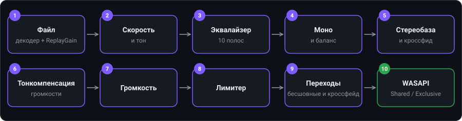

<div align="center">


# Lumisense

**Локальный аудиоплеер для Windows в духе Fluent Design.**<br>
Ваша музыка — на вашем диске: без стриминга, аккаунтов и подписок.

[Русский](README.md) · [English](README.en.md)

[](https://github.com/wasssly/Lumisense/releases)
[](https://github.com/wasssly/Lumisense/actions/workflows/ci.yml)
[](https://github.com/wasssly/Lumisense)
[](https://dotnet.microsoft.com/)
[](LICENSE)
[](https://t.me/LumisenseApp)

[**Скачать**](https://github.com/wasssly/Lumisense/releases) · [Возможности](#главное) · [Звук](#путь-звука) · [Приватность](#приватность) · [Сборка](#сборка-из-исходников) · [Обратная связь](#обратная-связь)

</div>

<br>

## Главное

<table>
  <tr>
    <td valign="top" width="33%"><b>Звук без компромиссов</b><br>Десятиполосный эквалайзер, лимитер, ReplayGain и замер громкости EBU R128, кроссфейд, бесшовные переходы, WASAPI Exclusive.</td>
    <td valign="top" width="33%"><b>Живые тексты</b><br>Синхронные <code>.lrc</code>, поиск в LRCLIB, пресеты оформления и полноэкранный Now Playing с анимированным фоном.</td>
    <td valign="top" width="33%"><b>Пять видов окна</b><br>«Новый», «Стекло», «Винил», «Компакт» и «Постер» — плюс мини-плеер и плавающий «остров».</td>
  </tr>
  <tr>
    <td valign="top" width="33%"><b>Библиотека без сюрпризов</b><br>Папки, избранное, очередь, пять режимов шаффла, редактор тегов и обложек, поиск обложек в сети.</td>
    <td valign="top" width="33%"><b>Приватность по умолчанию</b><br>Онлайн-функции опциональны и перечислены в <a href="docs/NETWORK_AND_PRIVACY.md">одном документе</a>. Логи никуда не уходят.</td>
    <td valign="top" width="33%"><b>Безопасные обновления</b><br>GitHub Releases, проверка SHA-256, аттестация сборки, компактные обновления Velopack.</td>
  </tr>
</table>

> **Дисклеймер.** Lumisense в значительной степени создавался с помощью **Claude** и **Manus AI** и первоначально разрабатывался для личного использования — под привычки и предпочтения автора, а не как универсальный продукт для всех. Поэтому часть решений может быть субъективной, а некоторые функции — ещё требовать доработки. Нашли ошибку или не хватает важной возможности — создайте [issue](https://github.com/wasssly/Lumisense/issues).

## Установка

| Что нужно | Что скачать на [GitHub Releases](https://github.com/wasssly/Lumisense/releases) |
|:--|:--|
| Обычная установка и обновление | **`Lumisense-<версия>-Setup.exe`** |
| Компактные обновления Velopack | `Lumisense-<версия>-win-x64.msi` — по желанию, администратор запросит Windows |
| Служебные файлы | `.nupkg`, `RELEASES`, `releases.win.json` — вручную не запускать |

Разбор файлов релиза и сценариев EXE/MSI: [docs/UPDATES.md](docs/UPDATES.md). Новости и анонсы — в Telegram: [@LumisenseApp](https://t.me/LumisenseApp).

## Возможности

Разделы свёрнуты, чтобы страницу было удобно просматривать: раскройте нужный.

<details open>
<summary><b>Воспроизведение и очередь</b></summary>

<br>

- **Форматы:** MP3, WAV, WMA, FLAC, M4A, AAC, OGG, OPUS, AIFF.
- **Управление:** пуск, пауза, стоп, предыдущий и следующий трек, перемотка; повтор — выкл., весь плейлист или один трек.
- **«Играть следующим»:** отдельная очередь с поиском и сортировкой; очередь и история шаффла сохраняются между запусками.
- **Переходы:** бесшовные (бета) и кроссфейд при автопереходе; треки одного альбома можно не смешивать.
- **Память:** последний трек и позиция запоминаются; автовозобновление при запуске отключается.

**Режимы шаффла**

| Режим | Как выбирается следующий трек |
|:--|:--|
| **Колода** (по умолчанию) | Плейлист тасуется один раз, и трек не повторится, пока не сыграют все остальные |
| **Случайный** | Из всего плейлиста; повторы возможны, но не два раза подряд |
| **Любимые чаще** | Избранное выпадает втрое чаще остальных |
| **Редкие чаще** | Чаще те, что вы слушали реже всего (по счётчику прослушиваний) |
| **По папкам** | Папка или альбом играет подряд, затем случайная ещё не игравшая; папки не повторяются, пока не сыграют все |

</details>

<details>
<summary><b>Звук</b> (цепочка обработки — в разделе <a href="#путь-звука">«Путь звука»</a>)</summary>

<br>

- **Эквалайзер:** десять полос, пресеты и свои настройки; включается без щелчков, а выключенный не обрабатывает звук.
- **Скорость и тон** без изменения исходного файла; скорость может менять и тон — «как на виниле».
- **Громкость:** ReplayGain (трековый и альбомный режимы, предусилитель, Opus R128). Для файлов без тегов плеер сам измеряет громкость по EBU R128 в фоне и выравнивает до −18 LUFS. Кривая громкости — логарифмическая или обычная.
- **Лимитер:** прозрачно ослабляет только пики выше −0,1 dBFS (задержка около 2 мс).
- **Пространство:** ширина стереобазы, кроссфид для наушников, тонкомпенсация громкости, моно-режим и баланс.
- **Вывод:** любое устройство Windows; эквалайзер и баланс можно запоминать отдельно для каждого. WASAPI Shared (по умолчанию) или Exclusive с автоматическим возвратом в Shared, настраиваемая задержка и повышенный приоритет процесса. Если сохранённое устройство пропало, звук восстанавливается на системном.
- **Путь сигнала:** строка в настройках вывода показывает, какие этапы обработки включены; «bit-perfect» отмечается только без обработки и в режиме Exclusive на частоте файла.
- **Экспорт MP3** с текущими скоростью и тоном; оригинал не перезаписывается. Кодирует встроенный LAME (libmp3lame), кодеки Windows не нужны.

</details>

<details>
<summary><b>Плейлист и коллекция</b></summary>

<br>

- **Состав:** файлы, папки (вложенные и пустые), группировка по папкам, сворачивание групп, отключение отдельных папок; новые файлы в отслеживаемых папках подхватываются сами.
- **Работа со списком:** поиск, виртуализированный список для больших коллекций, выделение через `Ctrl` и `Shift`, Drag & Drop; если файл уже в плейлисте, плеер раскрывает его папку и подсвечивает трек.
- **Избранное:** отдельный вид; анимация сердечка — «Заливка», «Искры», «Кольцо» или выключена.
- **Недоступные файлы** с диска не удаляются: можно найти замену или убрать только запись.
- **Теги и обложки:** редактор тегов, свойств и обложки; плашки с форматом, битрейтом, частотой и размером файла.
- **Поиск обложек:** iTunes, Deezer и MusicBrainz; неофициальные Yandex Music, Genius и SoundCloud выключены по умолчанию. Найденное кэшируется локально.
- **Контекстное меню трека:** порядок пунктов меняется перетаскиванием, лишние скрываются.
- **Имена файлов:** нормализация по шаблону.

</details>

<details>
<summary><b>Тексты песен</b></summary>

<br>

- **Форматы:** синхронные `.lrc`; обычные — из `.txt` и тега Comment. Работает ручная загрузка.
- **Автопоиск:** встроенный LRCLIB; выбор учитывает название, исполнителя и длительность. Политика поиска: только локальные источники, автоматический точный поиск или ручной.
- **Оформление:** размер, выравнивание, подсветка активной строки, масштаб, свечение, размытие и затухание соседних строк, стиль перехода. Встроенные пресеты — «Классика», «Apple Music», «Караоке», «Минимализм» — и свои.
- **Now Playing:** клик по строке перематывает трек; если найдено несколько вариантов текста, между ними можно переключаться.
- **Кэш** текстов и обложек хранится локально и очищается из настроек.

**Дополнительные источники** выключены общим переключателем. После включения название и исполнитель уходят только в отмеченные сервисы:

| Сервис | Отмечен по умолчанию | Особенность |
|:--|:--:|:--|
| NetEase Cloud Music, QQ Music | Да | Через Lyricify.Lyrics.Helper (Apache-2.0) |
| Kugou | Да | Только HTTPS |
| Paxsenix | Да | Неофициальный прокси к текстам Apple Music |
| Better Lyrics | — | Без ключа находит только треки из своего кэша |
| Binimum | — | Каталог ссылок на TTML |
| LyricsPlus | — | Запасной адрес при сбое основного |

Результаты идут после LRCLIB и помечены источником.

</details>

<details>
<summary><b>Окна и внешний вид</b></summary>

<br>

| Режим | Что это |
|:--|:--|
| **Главное окно** | Виды «Новый» (крупная обложка), «Стекло», «Винил», «Компакт», «Постер» |
| **Мини-плеер** | Прозрачность (ползунок, колёсико, ввод числа), прилипание к краям, пресеты размера, бегущая строка для длинных имён, фон под цвет обложки, жесты. Обложка — стандартная, вращающийся винил или статичный круг; контур прогресса толщиной 2–4 |
| **Остров** | Плавающая панель с обложкой и управлением. Формы: «Капсула», «Круг», «Notch Nook» (свисает с верхнего края и раскрывается при наведении). Контур прогресса, эквалайзер по спектру, карточка подключения устройства, приём файлов перетаскиванием |
| **Now Playing** | Полноэкранный режим с обложкой, управлением и текстом; фон — «Облака из цветов обложки», «Цветные шары» или «Волны» |

**Оформление**

- **Полоса прогресса:** обычный ползунок, Waveform (форма звука; считается один раз при загрузке трека, только в главном окне), «Material» и «Material Slider»; смена обложки — «Слайд» или «Карусель».
- **Навигация настроек:** боковая панель, таблетки сверху или плавающая нижняя панель (подписи скрываются, показываются под значками или только у выбранного пункта).
- **Иконки:** шесть наборов (Duotone, Outline, Bold, Fill, Thin, Font Awesome) переключаются без перезапуска. Пять значков приложения — Glass, Spotlight, Backlit, Stripes, Beam — для окон, трея и ярлыков.
- **Тема:** светлая и тёмная, системный или свой акцент, Mica/Acrylic, масштаб 85–135%, режим «Снизить движение», русский и английский языки.
- **Уведомление о смене трека:** положение, монитор, размер, ширина, сторона обложки, выравнивание, прозрачность; закрывается кликом.
- **Игры и оверлеи:** режим совместимости включается вручную или сам при игре на весь экран и известных оверлеях (RTSS, Xbox Game Bar, Steam, NVIDIA, AMD).
- **Автопрокрутка** настроек средней кнопкой мыши: первый клик включает, второй выключает.

</details>

<details>
<summary><b>Интеграции с Windows и Discord</b></summary>

<br>

- Медиаклавиши и System Media Transport Controls.
- **Глобальные горячие клавиши** (по умолчанию не назначены, есть сброс всех): воспроизведение/пауза, следующий и предыдущий, стоп, громкость, без звука, шаффл, повтор, избранное, текст, мини-плеер, перемотка вперёд и назад, удаление трека.
- **Трей:** собственное меню (управление и «Настройки»), сворачивание в трей вместо закрытия, автозапуск с Windows — в том числе свёрнутым.
- **Ярлыки** на рабочем столе и в меню «Пуск» (в установщике — отдельные опции).
- **Discord Rich Presence** с настройками приватности: данные трека, таймлайн, кнопки «GitHub» и «Скачать Lumisense» (включаются отдельно) и обложка (ищется по названию и исполнителю через iTunes, затем Deezer; берётся только результат того же исполнителя).

</details>

<details>
<summary><b>Данные, диагностика и обновления</b></summary>

<br>

- **Статистика:** счётчик прослушиваний и отдельное окно; прослушивание засчитывается по фактически проигранному времени, перемотка в конец его не даёт.
- **Профиль:** экспорт и импорт всех настроек в один `.lumi`-файл.
- **Надёжность:** версионные миграции настроек, проверка и исправление значений при запуске, резервные копии и локальные точки восстановления перед сбросом.
- **Диагностика:** аудиовывод, фоновые операции, производительность (процессор, память, дескрипторы, проверка утечек), ограничение размера логов. Ничего не отправляется.
- **Список изменений:** категории, поиск и сортировка; автоперевод по желанию (выключен по умолчанию).
- **Обновления:** проверка через GitHub Releases, SHA-256 установщика проверяется до запуска, для релизных установщиков публикуется аттестация происхождения сборки; перед перезапуском плеер просит подтверждение.
- **Зеркало загрузки:** можно выбрать вручную; плеер предупреждает, что зеркало видит IP-адрес и факт скачивания, но не может подменить файл.

</details>

## Путь звука

Так звук проходит от файла до устройства. Лишние этапы можно отключить, а при полностью выключенной обработке в режиме Exclusive сигнал идёт bit-perfect.

<p align="center"></p>

## Приватность

Плеер работает локально и сам ничего не отправляет, пока вы не включите онлайн-функцию. Логи не отправляются автоматически, а имена пользователей в путях маскируются.

| Функция | Куда обращается | Что уходит |
|:--|:--|:--|
| Проверка и загрузка обновлений | GitHub Releases (или выбранное вами зеркало) | Версия приложения |
| Автопоиск текста | LRCLIB | Название и исполнитель |
| Дополнительные источники текстов | Только отмеченные вами сервисы | Название и исполнитель |
| Поиск обложек | iTunes, Deezer, MusicBrainz и др. | Поисковая строка, по запуску в окне поиска |
| Обложка для Discord | iTunes, затем Deezer | Название и исполнитель |
| Автоперевод журнала изменений | Google Translate (неофициальный) | Публичный текст журнала |

Полная таблица запросов, правила хранения данных и логов — в [docs/NETWORK_AND_PRIVACY.md](docs/NETWORK_AND_PRIVACY.md).

## Сборка из исходников

Нужны Windows 10 или 11, .NET 10 SDK и Git. Для Visual Studio — Visual Studio 2022 с workload **.NET desktop development**. В репозитории отдельные проекты приложения и тестов, поэтому пути к `.csproj` указываются явно:

```powershell
git clone https://github.com/wasssly/Lumisense.git
cd Lumisense

dotnet restore .\Lumisense\Lumisense.csproj
dotnet run --project .\Lumisense\Lumisense.csproj                 # запуск
dotnet build .\Lumisense\Lumisense.csproj -c Release              # сборка Release
dotnet test .\Lumisense.Tests\Lumisense.Tests.csproj -c Release   # тесты
```

В Visual Studio откройте `Lumisense/Lumisense.csproj`. Правила работы над кодом — в [AGENTS.md](AGENTS.md).

<details>
<summary><b>Технологии</b></summary>

<br>

| Компонент | Для чего |
|:--|:--|
| **.NET 10**, **WPF** | Приложение |
| [WPF-UI](https://github.com/lepoco/wpfui) | Fluent-компоненты, оформление окна, значок в трее |
| [NAudio](https://github.com/naudio/NAudio) | Декодирование и воспроизведение |
| SoundTouch.Net | Скорость и тон |
| [LAME](https://lame.sourceforge.io/) (`libmp3lame`, LGPL, загружается динамически) | MP3-экспорт |
| [ATL.NET](https://github.com/Zeugma440/atldotnet) | Теги и обложки |
| [SharpVectors](https://github.com/ElinamLLC/SharpVectors) | SVG |
| [Velopack](https://github.com/velopack/velopack) | Компактные обновления |
| DiscordRichPresence | Discord |
| Lyricify.Lyrics.Helper | NetEase Cloud Music и QQ Music (по желанию) |
| xUnit v3, Microsoft Testing Platform | Тесты |

Иконки: Phosphor (MIT) и Font Awesome Free 7 (CC BY 4.0, https://fontawesome.com). Фигуры индикатора загрузки адаптированы из Material Shapes (Apache-2.0). Тексты лицензий — в `Lumisense/Icons/` и `docs/`.

</details>

<details>
<summary><b>Структура репозитория</b></summary>

<br>

```text
Lumisense/
├── .github/workflows/        — ci.yml (сборка, тесты, зависимости), release.yml (релиз по тегу),
│                               velopack-local-update-test.yml (проверка обновления на локальном feed)
├── Installer/Lumisense.iss   — сценарий установщика Inno Setup
├── docs/                     — UPDATES, NETWORK_AND_PRIVACY, PERFORMANCE_BASELINE, VELOPACK_*,
│                               тексты лицензий
├── tools/                    — скрипты подготовки релиза, замеров и очистки интеграции с оболочкой
├── Lumisense.Tests/          — unit-тесты
├── Lumisense/                — исходный код плеера
│   ├── MainWindow*           — главное окно; логика разделена по файлам MainWindow.*.cs
│   ├── MiniPlayerWindow*     — мини-плеер
│   ├── IslandPlayerWindow*   — остров
│   ├── NowPlayingWindow*     — полноэкранный Now Playing
│   ├── SettingsWindow*       — настройки
│   ├── Audio*, Playback*     — вывод звука, восстановление, координация воспроизведения
│   ├── *SampleProvider.cs    — цепочка обработки: эквалайзер, скорость/тон, лимитер, стереобаза, громкость
│   ├── Lyrics*, *LyricsSource.cs — загрузка, разбор и источники текстов
│   ├── CoverArt*             — поиск и свойства обложек
│   ├── Update*, Velopack*    — проверка и установка обновлений
│   ├── AppSettings.cs, LumiProfile.cs — настройки и профили
│   ├── LocalizationService.cs, LocalizationResources.cs — русская и английская локализация
│   ├── Changelog/            — история изменений
│   ├── Icons/                — наборы SVG-иконок и значки приложения
│   └── lib/                  — libmp3lame.dll и уведомление о лицензии LAME
├── AGENTS.md                 — правила работы над проектом
├── LICENSE                   — GPL-3.0
├── THIRD-PARTY-NOTICES.md    — лицензии компонентов
└── global.json               — версия .NET SDK
```

</details>

## Лицензия

Lumisense распространяется под лицензией [GNU GPL v3.0](LICENSE). Лицензии используемых компонентов перечислены в [THIRD-PARTY-NOTICES.md](THIRD-PARTY-NOTICES.md); эти файлы и тексты лицензий входят в установленное приложение.

## Обратная связь

Перед созданием issue проверьте, что у вас последняя версия. В сообщении укажите:

1. версию Lumisense и версию Windows;
2. шаги воспроизведения проблемы;
3. ожидаемый и фактический результат;
4. скриншот или очищенный фрагмент лога, если это помогает.

Не прикладывайте логи с личными путями и именами пользователей без предварительной правки.

<div align="center">

[Issues](https://github.com/wasssly/Lumisense/issues) · [Releases](https://github.com/wasssly/Lumisense/releases) · [Telegram @LumisenseApp](https://t.me/LumisenseApp)

</div>
